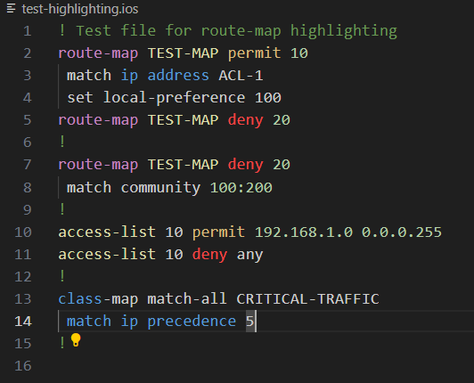

# Cisco IOS Highlighter — Lawson Cyber LLC

Review Cisco configuration text in Visual Studio Code. Lawson Cyber LLC maintains this extension.

## Features

- Highlight command keywords, addresses, interface names, and configuration sections.
- Open `.ios`, `.cisco`, `.nxos`, and `.asa` files with the Cisco language mode.
- Use 31 command snippets. Type a snippet prefix, such as `add-vlan`, then select the snippet.
- Find repeated sequence numbers in route maps, prefix lists, and access lists.
- Read duplicate line references in hover text and the Problems panel.
- Find identical access-list rules after space normalization.

The grammar includes command forms from IOS, IOS-XE, NX-OS, and ASA. Highlighting and diagnostics provide review aids. They do not validate a configuration or establish device behavior. Check each diagnostic before you change a device configuration.

## Preview

## Use

1. Install [Cisco IOS Highlighter](https://marketplace.visualstudio.com/items?itemName=DerickL.CiscoHighlighter).
2. Open a file with the `.ios`, `.cisco`, `.nxos`, or `.asa` extension.
3. If the file has another extension, select **Cisco** from the language mode control.
4. Open the Problems panel to review diagnostics. Hover over a duplicate sequence for line references.

Version 1.0.6 registers the existing snippets. It preserves names with hyphens in duplicate messages. It compares the complete access-list rule text to prevent false redundancy warnings.

## Platform highlighting in 1.0.7

- NX-OS: feature declarations, VRF names, vPC commands, and interface identifiers.
- ASA LINA: object declarations, object references, NAT commands, interface names, and access-group commands.
- Command output: prompts, configuration headers, interface identifiers, addresses, MAC addresses, and link state words.
- Shared syntax: declaration names, IPv6 prefixes, comments, descriptions, remarks, and banner content.

LINA is the [ASA firewall engine](https://www.cisco.com/c/en/us/support/docs/security/firepower-ngfw/200950-Clarifying-the-Firepower-Threat-Defense.html). This extension colors text from saved configuration and command output. It does not connect to a firewall. It does not validate every command or output table. Exact colors depend on the editor theme.

The shared language cannot always distinguish banner formats. IOS banners with alphabetic delimiters use single-line highlighting. ASA banner text that starts with punctuation can be read as a delimiter. Check unusual banners in the editor.

The syntax tests use synthetic IOS, NX-OS, and ASA examples. They run the TextMate grammar with the same regular expression engine that Visual Studio Code uses.

## Local processing

The extension reads the open document in the editor. It makes no network requests. It uses no telemetry or external analysis service. The company link opens only when you select it. Other editor extensions and file synchronization have separate data handling rules.

## Support

Report errors through [GitHub issues](https://github.com/palthainon/CiscoHighlighter/issues). Use synthetic examples. Do not include passwords, keys, or customer configuration files.

[Lawson Cyber LLC](https://lawsoncyber.com) · [Source](https://github.com/palthainon/CiscoHighlighter)

## Development

Run `npm ci`, then `npm test`. Run `npm run test:host` for the isolated Visual Studio Code 1.102.0 checks. The editor test downloads the official editor build on its first run.

## License and credits

This extension is a fork of [vscode-cisco-syntax](https://github.com/woodjme/vscode-cisco-syntax).

This release uses the [MIT license](LICENSE). It retains the original Jamie Wood copyright notice. Earlier releases retain their published license terms.
